# Application Flow (AppFlow)
**Document ID:** `CC-SPEC-FLOW-v4.0`  
**System Name:** CellCheck PulsePod  
**Standard Compliance:** ASD-STE100, UML 2.5 State Machine Specifications  

---

## 1. End-to-End User Journey

```text
 ┌──────────────────┐      ┌──────────────────┐      ┌──────────────────┐      ┌──────────────────┐
 │ STEP 1: INSERT   │ ───► │ STEP 2: ARM & RUN│ ───► │ STEP 3: OBSERVE  │ ───► │ STEP 4: MINT &   │
 │ Clamp Cell into  │      │ Flip Master Arm; │      │ 60s Test Cycle;  │      │ LABEL            │
 │ 4-Wire V-Jaws    │      │ Strike Arcade PB │      │ Hear Glissando   │      │ Affix Passport   │
 └──────────────────┘      └──────────────────┘      └──────────────────┘      └──────────────────┘
```

### Step 1: Mechanical Clamping & Seating
1. The operator places the cylindrical cell into the universal Delrin V-groove clamp.
2. The spring-loaded jaws close around the cell.
3. The outer copper teeth seat firmly on the force terminals.
4. The inner gold pogo pins compress against the center of the terminal caps.
5. The 3D-printed shroud positions the MLX90614 infrared thermopile $8\text{ mm}$ above the positive vent crimp.
6. The compliant silicone elastomer pad presses the $40\text{ kHz}$ ultrasonic transducer disc against the bare steel cylinder wall.

### Step 2: System Arming & Triggering
1. The operator flips up the red avionics toggle guard.
2. The operator flips the toggle switch to `ARMED`.
3. The system executes a contact resistance check. The status LED turns solid white.
4. The operator presses the 30mm arcade push button.
5. The status LED changes to flashing cyan, indicating active test execution.

### Step 3: Multimodal Diagnostic Cycle (60 Seconds)
1. **$0\text{ to }5\text{ s}$:** The instrument checks open-circuit voltage ($V_{\text{ocv}}$). If $2.50\text{ V} \le V_{\text{ocv}} \le 4.25\text{ V}$, the test proceeds.
2. **$5\text{ to }10\text{ s}$:** The load switch draws $0.75\text{ A}$. The PRBS micro-chirp injects $10\text{ Hz}, 100\text{ Hz}, 1\text{ kHz}$ perturbations. The OLED screen draws the real-time voltage sag.
3. **$10\text{ to }35\text{ s}$:** The load switch opens. The magnetic buzzer sonifies the relaxation transient into an upward glissando. The OLED screen renders the Cole-Cole Nyquist arc. The ultrasonic transducer transmits a $40\text{ kHz}$ pulse train across the cell diameter.
4. **$35\text{ to }60\text{ s}$:** The micro-charge circuit injects $200\text{ mA}$. The system records active lithium insertion kinetics.

### Step 4: Classification, Label Printing & Handoff
1. At $t = 60.0\text{ s}$, the buzzer emits a clean double-chime.
2. The status LED turns:
   - **Solid Emerald Green:** Tier A (EV / High-Drain Second Life).
   - **Solid Amber Yellow:** Tier B (Solar Microgrid Storage).
   - **Solid Ruby Red:** Tier C (Immediate Materials Recycling).
   - **Blinking Magenta:** Retest / Conformal Uncertainty Rejection.
3. The thermal printer outputs the peel-and-stick W3C QR Battery Passport label.
4. The operator places the label onto the cell casing and removes the cell from the clamp.

---

## 2. Finite State Machine (FSM)

```mermaid
stateDiagram-v2
    [*] --> STATE_IDLE: System Power-On / Boot Verification

    STATE_IDLE --> STATE_CONTACT_CHECK: Cell Inserted (Vocv > 0.50V)
    STATE_CONTACT_CHECK --> STATE_IDLE: Cell Removed

    STATE_CONTACT_CHECK --> STATE_PRE_SCREEN: Master Arm Switch Activated

    state STATE_PRE_SCREEN {
        [*] --> Measure_Vocv_Tamb
        Measure_Vocv_Tamb --> Evaluate_Limits
    }

    STATE_PRE_SCREEN --> STATE_TRIP_LOCKOUT: Vocv < 2.50V (Copper Short) OR Vocv > 4.25V
    STATE_PRE_SCREEN --> STATE_ARMED_READY: 2.50V <= Vocv <= 4.25V

    STATE_ARMED_READY --> STATE_IDLE: Master Arm Deactivated
    STATE_ARMED_READY --> STATE_PHASE1_PULSE: Arcade Trigger Pressed

    state STATE_PHASE1_PULSE {
        [*] --> Load_Switch_ON: Close N-MOSFET (0.75A)
        Load_Switch_ON --> Calculate_R0: t = 5.020s (Instantaneous Step)
        Calculate_R0 --> Modulate_Chirp: t = 7.000s (Multi-tone 10Hz/100Hz/500Hz)
        Modulate_Chirp --> [*]: t = 10.000s (Open N-MOSFET)
    }

    STATE_PHASE1_PULSE --> STATE_TRIP_LOCKOUT: Vent Temp > 45.0°C OR E-Stop Activated
    STATE_PHASE1_PULSE --> STATE_PHASE2_RELAX: t = 10.000s Normal Transition

    state STATE_PHASE2_RELAX {
        [*] --> Sample_Relaxation: 100 Hz ADC Stream
        Sample_Relaxation --> Sonify_Glissando: Drive Piezo Tone (300Hz - 1500Hz)
        Sonify_Glissando --> Ultrasonic_Inspection: 40 kHz Transducer Burst
        Ultrasonic_Inspection --> Render_Cole_Cole: Plot Z' vs -Z'' on OLED
        Render_Cole_Cole --> [*]: t = 35.000s Completed
    }

    STATE_PHASE2_RELAX --> STATE_PHASE3_CHARGE: t = 35.000s (Zero Anomaly Flags)
    STATE_PHASE2_RELAX --> STATE_TRIP_LOCKOUT: Anomaly Detected (Thermal / Acoustic / Voltage)

    state STATE_PHASE3_CHARGE {
        [*] --> Verify_Phase_Interlocks: Check P0-P2 Anomaly Flags
        Verify_Phase_Interlocks --> Enable_TP4056: All Clean -> Assert GPIO27 (200 mA)
        Enable_TP4056 --> Compute_Polarization_Slope: Sample dV/dt (40s - 55s)
        Compute_Polarization_Slope --> Assemble_Feature_Vector: Vector x in R^8
        Assemble_Feature_Vector --> [*]: t = 60.000s Completed
    }

    STATE_PHASE3_CHARGE --> STATE_INFERENCE_MINT: t = 60.000s Normal Transition

    state STATE_INFERENCE_MINT {
        [*] --> Monotonic_XGB_Eval: Evaluate Tree Ensembles
        Monotonic_XGB_Eval --> Conformal_Gate: Compute Prediction Set C(x)
        Conformal_Gate --> Output_Definite_Grade: Set Size |C(x)| == 1
        Conformal_Gate --> Output_Retest_Flag: Set Size |C(x)| != 1
        Output_Definite_Grade --> Mint_Hardware_Signature: Sign via ESP32 eFuse Key
        Output_Retest_Flag --> Mint_Hardware_Signature: Sign Retest Record
        Mint_Hardware_Signature --> Rasterize_Label: Print W3C QR Passport
        Rasterize_Label --> [*]
    }

    STATE_INFERENCE_MINT --> STATE_IDLE: Cell Disengaged / Arm Cleared
    STATE_TRIP_LOCKOUT --> STATE_IDLE: Manual Fault Clear & Toggle Reset
```



---

## 3. Error Handling & Recovery Protocols

```text
┌──────────────┬────────────────────────┬────────────────────────────────────────────────────────┐
│ ERROR ID     │ FAULT CONDITION        │ DETERMINISTIC SYSTEM MITIGATION & RECOVERY             │
├──────────────┼────────────────────────┼────────────────────────────────────────────────────────┤
│ `ERR_V_LOW`  │ Vocv < 2.50V at P0     │ System locks out load switch. Red LED flashes at 5 Hz. │
│              │                        │ Buzzer emits continuous 200 Hz tone. Screen displays:  │
│              │                        │ "CRITICAL ERROR: CELL OVER-DISCHARGED / COPPER SHORT". │
│              │                        │ Action: Operator removes cell; routes to scrap bin.    │
├──────────────┼────────────────────────┼────────────────────────────────────────────────────────┤
│ `ERR_T_VENT` │ MLX90614 T > 45.0°C or │ Core 0 hardware ISR forces GPIO18 LOW within 12 µs.    │
│              │ dT/dt > 1.2°C/s        │ System trips latching lockout. Screen displays:        │
│              │                        │ "VENT OVER-TEMPERATURE DETECTED — LOAD TRIPPED".       │
│              │                        │ Action: Move cell immediately to sand-isolated bucket. │
├──────────────┼────────────────────────┼────────────────────────────────────────────────────────┤
│ `ERR_CONTACT`│ Contact voltage noise  │ Savitzky-Golay filter flags non-monotonic noise jump.  │
│              │ > 50 mV in pulse       │ Test aborts. Screen displays: "POOR CONTACT — CLEAN    │
│              │                        │ TERMINALS WITH ISOPROPYL ALCOHOL WIPES AND RE-CLAMP".  │
├──────────────┼────────────────────────┼────────────────────────────────────────────────────────┤
│ `ERR_COM_BLE`│ Serial USB cable falls │ Firmware activates background BLE GATT service.        │
│              │ out during cycle       │ Companion host catches disconnect and pairs via        │
│              │                        │ Web-Bluetooth API with zero loss of buffered records.  │
├──────────────┼────────────────────────┼────────────────────────────────────────────────────────┤
│ `ERR_CONFORM`│ Conformal set |C(x)|>1 │ Model refuses speculative guess. Screen displays:      │
│              │ (epistemic uncertainty)│ "RETEST — CONFORMAL UNCERTAINTY EXCEEDED".             │
│              │                        │ Printer outputs yellow label with manual audit flag.   │
└──────────────┴────────────────────────┴────────────────────────────────────────────────────────┘
```

---

## 4. Operational Safety & Quarantine Protocol

1. **Fireproof Tray Setup:**
   The operator shall place the PulsePod instrument inside a non-combustible catch tray. The tray must contain dry sand or vermiculite.

2. **Safe Standoff Distance:**
   The operator must maintain a safe distance of at least 1.0 meter during active pulsing and wear eye protection.

3. **Phase 3 Micro-Charge Interlock:**
   Firmware must verify that Phase 0 baseline voltage, Phase 1 Ohmic resistance, and Phase 2 relaxation/acoustic parameters exhibit zero anomalies. If any anomaly flag is set, firmware locks out Phase 3 (GPIO27 stays LOW). The instrument shall never charge a suspect cell.

4. **Cell Rejection and Isolation:**
   If a cell fails pre-screen or exhibits heating, the operator shall reject the cell. The operator shall use heat-resistant tongs to move the cell into a fireproof sand bucket. Never re-test a rejected cell.
