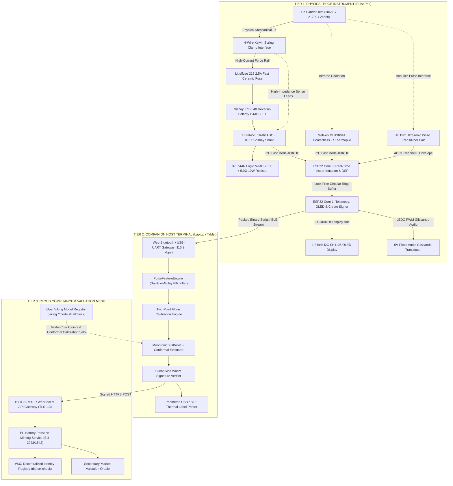
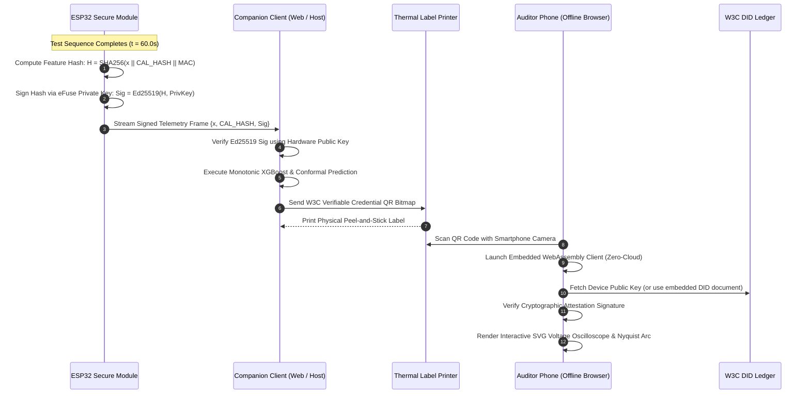

# System Architecture (Architecture)
**Document ID:** `CC-SPEC-ARCH-v4.0`  
**System Name:** CellCheck PulsePod  
**Standard Compliance:** ASD-STE100, System Design 101, W3C DID Core 1.0, EU Battery Directive (EU 2023/1542)  

---

## 1. Multi-Tier System Topology & Communication Mesh

The CellCheck architecture decomposes into three decoupled tiers: the physical Edge Instrument (PulsePod), the Companion Host Terminal (Local Client), and the Cloud Compliance & Valuation Mesh.



---

## 2. Hardware / Software Boundary Specification

The system maintains strict boundaries across the compute tiers to avoid latency bottlenecks and safety failures:

```text
┌───────────────────────────────┬───────────────────────────────┬───────────────────────────────┐
│ TIER 1: ESP32 EDGE INSTRUMENT │ TIER 2: COMPANION CLIENT      │ TIER 3: CLOUD SERVICES        │
├───────────────────────────────┼───────────────────────────────┼───────────────────────────────┤
│ • Synchronous 1.78 kHz ADC DMA│ • Savitzky-Golay FIR smooth   │ • W3C DID document anchor     │
│ • Hardware safety trip ISR    │ • Two-point affine transfer   │ • Central audit log indexing  │
│ • Local Cole-Cole calculation │ • Monotonic XGBoost traversal │ • Fleet valuation feed sync   │
│ • Sound synthesis glissando   │ • Conformal p-value gate      │ • Automated model retrain     │
│ • Ed25519 eFuse signature     │ • Thermal label rasterization │ • Regulatory reporting        │
│                               │                               │                               │
│ ZERO ML MODEL STORAGE         │ ZERO HARDWARE INTERRUPT LOADS │ ZERO REAL-TIME CRITICAL PATHS │
│ ZERO INTERNET ACCESS          │ ZERO CLOUD DEPENDENCY FOR DEMO│ ZERO DIRECT FIELD PULSE ACCESS│
└───────────────────────────────┴───────────────────────────────┴───────────────────────────────┘
```

1. **Edge Responsibility (ESP32):**
   - The ESP32 firmware executes hardware actuation, deterministic sensor polling, and raw signal processing.
   - It computes physical electrical variables ($R_0, R_{\text{ct}}, C_{\text{dl}}, \Delta T_{\text{IR}}, \text{Atten}_{\text{dB}}$).
   - It signs telemetry frames with the hardware private key stored in secure eFuse blocks.
   - The ESP32 does not evaluate decision trees or machine-learning models.

2. **Companion Host Responsibility (Local Client):**
   - The host application normalizes the feature vector using device-specific calibration coefficients ($\mathbf{A}, \mathbf{B}$).
   - It runs the monotonic gradient-boosted decision tree inference.
   - It computes the non-conformity score and evaluates the conformal prediction set $\mathcal{C}(\mathbf{x})$.
   - It rasterizes the physical QR code label and transmits it to the thermal label printer.

3. **Cloud Responsibility (Registry & Governance):**
   - Cloud services store historical battery degradation records for fleet analytics.
   - The cloud ledger anchors public keys corresponding to issued device DIDs (`did:cellcheck:CP-ESP32-XXXX`).
   - The cloud services distribute updated model checkpoints via OpenViking URIs.

---

## 3. Cryptographic Trust & Hardware Attestation Pipeline

Every minted battery passport carries cryptographic provenance linking the physical test to a certified instrument.



---

## 4. Pin-Accurate Electrical Interconnect Architecture

```text
==================================================================================================
                     CELLCHECK PULSEPOD HARDWARE PIN CONNECTIONS
==================================================================================================

  POWER RAILS:
  ESP32 3.3V  ──► VCC Pin on TI INA226 ADC
              ──► VCC Pin on Melexis MLX90614 Thermopile
              ──► VCC Pin on 1.3" SH1106 I2C OLED Display
              ──► High side of 2.2kΩ I2C pullup resistors
  ESP32 GND   ──► Common System Ground Rail (Logic GND, Sensor GND, Shunt Low-Side)

  I2C BUS 0 (400 kHz Fast-Mode):
  ESP32 GPIO21 ──► SDA on INA226 (0x40), MLX90614 (0x5A), SH1106 (0x3C)
  ESP32 GPIO22 ──► SCL on INA226 (0x40), MLX90614 (0x5A), SH1106 (0x3C)

  ACTUATION & POWER CONTROL:
  ESP32 GPIO18 ──► Gate Resistor (100Ω) ──► E-Stop (NC) ──► Gate of IRLZ44N N-MOSFET
                   [Note: 10kΩ pulldown resistor to GND holds gate LOW during boot]
  ESP32 GPIO27 ──► Enable Pin on TP4056 Micro-Charge Regulator Module

  ULTRASONIC & ACOUSTIC CHANNELS:
  ESP32 GPIO19 ──► 40 kHz Transmit Drive (LEDC PWM Channel 1)
  ESP32 GPIO34 ──► 40 kHz Receive Envelope Detector Output (ADC1 Channel 6)
  ESP32 GPIO25 ──► 5V Magnetic Buzzer / Audio Stethoscope (LEDC PWM Channel 0)

  OPERATOR SWITCHES & SAFETY INTERLOCKS:
  ESP32 GPIO5  ──► Sanwa 30mm Arcade Trigger Button (Internal PULLUP, Active LOW)
  ESP32 GPIO16 ──► Aircraft Master Arm Safety Toggle (Active HIGH when armed)

  STATUS INDICATORS:
  ESP32 GPIO12 ──► Red Anode on Common-Cathode RGB LED (220Ω Limiter)
  ESP32 GPIO13 ──► Green Anode on Common-Cathode RGB LED (220Ω Limiter)
  ESP32 GPIO14 ──► Blue Anode on Common-Cathode RGB LED (220Ω Limiter)

==================================================================================================
```
